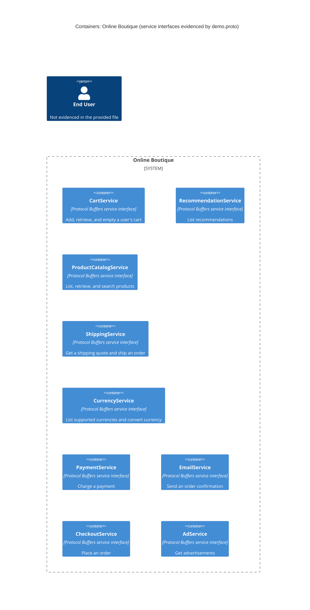

# Recovered Architecture

## Agent

AI assistant using Copilot SDK in VS Code; model not known.

## Files read

- `AGENTS.md`
- `prompts/1-recover-architecture.md`
- `system/online-boutique/protos/demo.proto`

## Containers table

The file defines these service interfaces. It does not establish whether each is deployed as a runtime container.

| Name | Technology/language | Responsibility | Evidence |
|---|---|---|---|
| CartService | Protocol Buffers service interface; implementation language not evidenced | Add, retrieve, and empty a user's cart | `system/online-boutique/protos/demo.proto` (`CartService`) |
| RecommendationService | Protocol Buffers service interface; implementation language not evidenced | List recommendations | `system/online-boutique/protos/demo.proto` (`RecommendationService`) |
| ProductCatalogService | Protocol Buffers service interface; implementation language not evidenced | List, retrieve, and search products | `system/online-boutique/protos/demo.proto` (`ProductCatalogService`) |
| ShippingService | Protocol Buffers service interface; implementation language not evidenced | Get a shipping quote and ship an order | `system/online-boutique/protos/demo.proto` (`ShippingService`) |
| CurrencyService | Protocol Buffers service interface; implementation language not evidenced | List supported currencies and convert currency | `system/online-boutique/protos/demo.proto` (`CurrencyService`) |
| PaymentService | Protocol Buffers service interface; implementation language not evidenced | Charge a payment | `system/online-boutique/protos/demo.proto` (`PaymentService`) |
| EmailService | Protocol Buffers service interface; implementation language not evidenced | Send an order confirmation | `system/online-boutique/protos/demo.proto` (`EmailService`) |
| CheckoutService | Protocol Buffers service interface; implementation language not evidenced | Place an order | `system/online-boutique/protos/demo.proto` (`CheckoutService`) |
| AdService | Protocol Buffers service interface; implementation language not evidenced | Get advertisements | `system/online-boutique/protos/demo.proto` (`AdService`) |

## Dependencies table

No runtime caller-to-callee dependencies or transport protocols are evidenced in the provided file.

| Caller → callee | Protocol | Evidence |
|---|---|---|
| Not evidenced in the provided files | Not evidenced in the provided files | `system/online-boutique/protos/demo.proto` declares service RPCs but does not show callers or runtime connections |

## Mermaid diagram

## Gaps

- The file describes service interfaces, but does not confirm deployed containers, implementation technologies, or data stores. Service implementation files or deployment manifests would settle these.
- RPC method declarations are present, but runtime callers, dependencies, and transport protocols are not shown. Caller/service source code or runtime configuration would settle these.
- An end user is not described in the file; frontend or user-interaction evidence would be needed to establish one.
