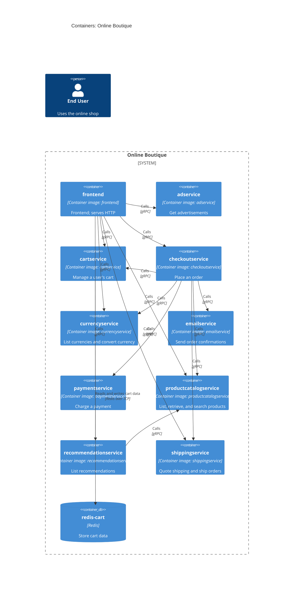

# Recovered Architecture

## Agent

AI assistant using Copilot SDK in VS Code; model not known.

## Files read

- `prompts/1-recover-architecture.md`
- `system/online-boutique/protos/demo.proto`
- `system/online-boutique/kubernetes-manifests/README.md`
- `system/online-boutique/kubernetes-manifests/adservice.yaml`
- `system/online-boutique/kubernetes-manifests/cartservice.yaml`
- `system/online-boutique/kubernetes-manifests/checkoutservice.yaml`
- `system/online-boutique/kubernetes-manifests/currencyservice.yaml`
- `system/online-boutique/kubernetes-manifests/emailservice.yaml`
- `system/online-boutique/kubernetes-manifests/frontend.yaml`
- `system/online-boutique/kubernetes-manifests/kustomization.yaml`
- `system/online-boutique/kubernetes-manifests/loadgenerator.yaml`
- `system/online-boutique/kubernetes-manifests/paymentservice.yaml`
- `system/online-boutique/kubernetes-manifests/productcatalogservice.yaml`
- `system/online-boutique/kubernetes-manifests/recommendationservice.yaml`
- `system/online-boutique/kubernetes-manifests/shippingservice.yaml`

## Containers table

The manifests identify the image used for each service, but do not establish its implementation language. Responsibilities are described by the RPC interfaces in `demo.proto`.

| Name | Technology/language | Responsibility | Evidence |
|---|---|---|---|
| frontend | Container image `frontend`; language not evidenced | Frontend; serves HTTP on port 80 | `system/online-boutique/kubernetes-manifests/frontend.yaml` |
| adservice | Container image `adservice`; language not evidenced | Get advertisements | `system/online-boutique/kubernetes-manifests/adservice.yaml`; `system/online-boutique/protos/demo.proto` (`AdService`) |
| cartservice | Container image `cartservice`; language not evidenced | Add, retrieve, and empty a user's cart | `system/online-boutique/kubernetes-manifests/cartservice.yaml`; `system/online-boutique/protos/demo.proto` (`CartService`) |
| checkoutservice | Container image `checkoutservice`; language not evidenced | Place an order | `system/online-boutique/kubernetes-manifests/checkoutservice.yaml`; `system/online-boutique/protos/demo.proto` (`CheckoutService`) |
| currencyservice | Container image `currencyservice`; language not evidenced | List supported currencies and convert currency | `system/online-boutique/kubernetes-manifests/currencyservice.yaml`; `system/online-boutique/protos/demo.proto` (`CurrencyService`) |
| emailservice | Container image `emailservice`; language not evidenced | Send an order confirmation | `system/online-boutique/kubernetes-manifests/emailservice.yaml`; `system/online-boutique/protos/demo.proto` (`EmailService`) |
| paymentservice | Container image `paymentservice`; language not evidenced | Charge a payment | `system/online-boutique/kubernetes-manifests/paymentservice.yaml`; `system/online-boutique/protos/demo.proto` (`PaymentService`) |
| productcatalogservice | Container image `productcatalogservice`; language not evidenced | List, retrieve, and search products | `system/online-boutique/kubernetes-manifests/productcatalogservice.yaml`; `system/online-boutique/protos/demo.proto` (`ProductCatalogService`) |
| recommendationservice | Container image `recommendationservice`; language not evidenced | List recommendations | `system/online-boutique/kubernetes-manifests/recommendationservice.yaml`; `system/online-boutique/protos/demo.proto` (`RecommendationService`) |
| shippingservice | Container image `shippingservice`; language not evidenced | Get a shipping quote and ship an order | `system/online-boutique/kubernetes-manifests/shippingservice.yaml`; `system/online-boutique/protos/demo.proto` (`ShippingService`) |
| redis-cart | Redis (`redis:alpine`) | Cart data store; cartservice configures its address | `system/online-boutique/kubernetes-manifests/cartservice.yaml` (`redis-cart` Deployment and Service; `REDIS_ADDR`) |

`kustomization.yaml` lists the application manifests above; it comments out `loadgenerator.yaml`, so loadgenerator is not included as an application container in this diagram.

## Dependencies table

The manifests' service-address variables identify configured destinations. The gRPC labels are supported by the destination Services' `grpc` ports and the RPC service definitions in `demo.proto`.

| Caller → callee | Protocol | Evidence |
|---|---|---|
| frontend → productcatalogservice | gRPC | `system/online-boutique/kubernetes-manifests/frontend.yaml` (`PRODUCT_CATALOG_SERVICE_ADDR`); `productcatalogservice.yaml` (`grpc` port); `system/online-boutique/protos/demo.proto` (`ProductCatalogService`) |
| frontend → currencyservice | gRPC | `system/online-boutique/kubernetes-manifests/frontend.yaml` (`CURRENCY_SERVICE_ADDR`); `currencyservice.yaml` (`grpc` port); `system/online-boutique/protos/demo.proto` (`CurrencyService`) |
| frontend → cartservice | gRPC | `system/online-boutique/kubernetes-manifests/frontend.yaml` (`CART_SERVICE_ADDR`); `cartservice.yaml` (`grpc` port); `system/online-boutique/protos/demo.proto` (`CartService`) |
| frontend → recommendationservice | gRPC | `system/online-boutique/kubernetes-manifests/frontend.yaml` (`RECOMMENDATION_SERVICE_ADDR`); `recommendationservice.yaml` (`grpc` port); `system/online-boutique/protos/demo.proto` (`RecommendationService`) |
| frontend → shippingservice | gRPC | `system/online-boutique/kubernetes-manifests/frontend.yaml` (`SHIPPING_SERVICE_ADDR`); `shippingservice.yaml` (`grpc` port); `system/online-boutique/protos/demo.proto` (`ShippingService`) |
| frontend → checkoutservice | gRPC | `system/online-boutique/kubernetes-manifests/frontend.yaml` (`CHECKOUT_SERVICE_ADDR`); `checkoutservice.yaml` (`grpc` port); `system/online-boutique/protos/demo.proto` (`CheckoutService`) |
| frontend → adservice | gRPC | `system/online-boutique/kubernetes-manifests/frontend.yaml` (`AD_SERVICE_ADDR`); `adservice.yaml` (`grpc` port); `system/online-boutique/protos/demo.proto` (`AdService`) |
| checkoutservice → productcatalogservice | gRPC | `system/online-boutique/kubernetes-manifests/checkoutservice.yaml` (`PRODUCT_CATALOG_SERVICE_ADDR`); `productcatalogservice.yaml` (`grpc` port); `system/online-boutique/protos/demo.proto` (`ProductCatalogService`) |
| checkoutservice → shippingservice | gRPC | `system/online-boutique/kubernetes-manifests/checkoutservice.yaml` (`SHIPPING_SERVICE_ADDR`); `shippingservice.yaml` (`grpc` port); `system/online-boutique/protos/demo.proto` (`ShippingService`) |
| checkoutservice → paymentservice | gRPC | `system/online-boutique/kubernetes-manifests/checkoutservice.yaml` (`PAYMENT_SERVICE_ADDR`); `paymentservice.yaml` (`grpc` port); `system/online-boutique/protos/demo.proto` (`PaymentService`) |
| checkoutservice → emailservice | gRPC | `system/online-boutique/kubernetes-manifests/checkoutservice.yaml` (`EMAIL_SERVICE_ADDR`); `emailservice.yaml` (`grpc` port); `system/online-boutique/protos/demo.proto` (`EmailService`) |
| checkoutservice → currencyservice | gRPC | `system/online-boutique/kubernetes-manifests/checkoutservice.yaml` (`CURRENCY_SERVICE_ADDR`); `currencyservice.yaml` (`grpc` port); `system/online-boutique/protos/demo.proto` (`CurrencyService`) |
| checkoutservice → cartservice | gRPC | `system/online-boutique/kubernetes-manifests/checkoutservice.yaml` (`CART_SERVICE_ADDR`); `cartservice.yaml` (`grpc` port); `system/online-boutique/protos/demo.proto` (`CartService`) |
| recommendationservice → productcatalogservice | gRPC | `system/online-boutique/kubernetes-manifests/recommendationservice.yaml` (`PRODUCT_CATALOG_SERVICE_ADDR`); `productcatalogservice.yaml` (`grpc` port); `system/online-boutique/protos/demo.proto` (`ProductCatalogService`) |
| cartservice → redis-cart | Redis over TCP | `system/online-boutique/kubernetes-manifests/cartservice.yaml` (`REDIS_ADDR`; Redis Service port `tcp-redis`) |

## Mermaid diagram

## Gaps

- Implementation languages are not evidenced by image names or the provided protocol definitions. The relevant service source files or Dockerfiles would settle this.
- `frontend.yaml` sets `SHOPPING_ASSISTANT_SERVICE_ADDR` to `shoppingassistantservice:80`, but no matching Service or Deployment is listed in `kustomization.yaml`. The provided files do not establish whether it is an active runtime dependency or its protocol. The shopping-assistant deployment/configuration and frontend code would settle this.
- `loadgenerator.yaml` defines a workload, but `kustomization.yaml` comments it out and notes that development uses a loadgenerator module in Skaffold. Whether and how it runs in the intended environment is not established; the relevant Skaffold configuration would settle this.
- The manifests expose frontend through a LoadBalancer Service on HTTP port 80, but do not identify an end user or establish its access path. Ingress or deployment/environment documentation would settle this.
